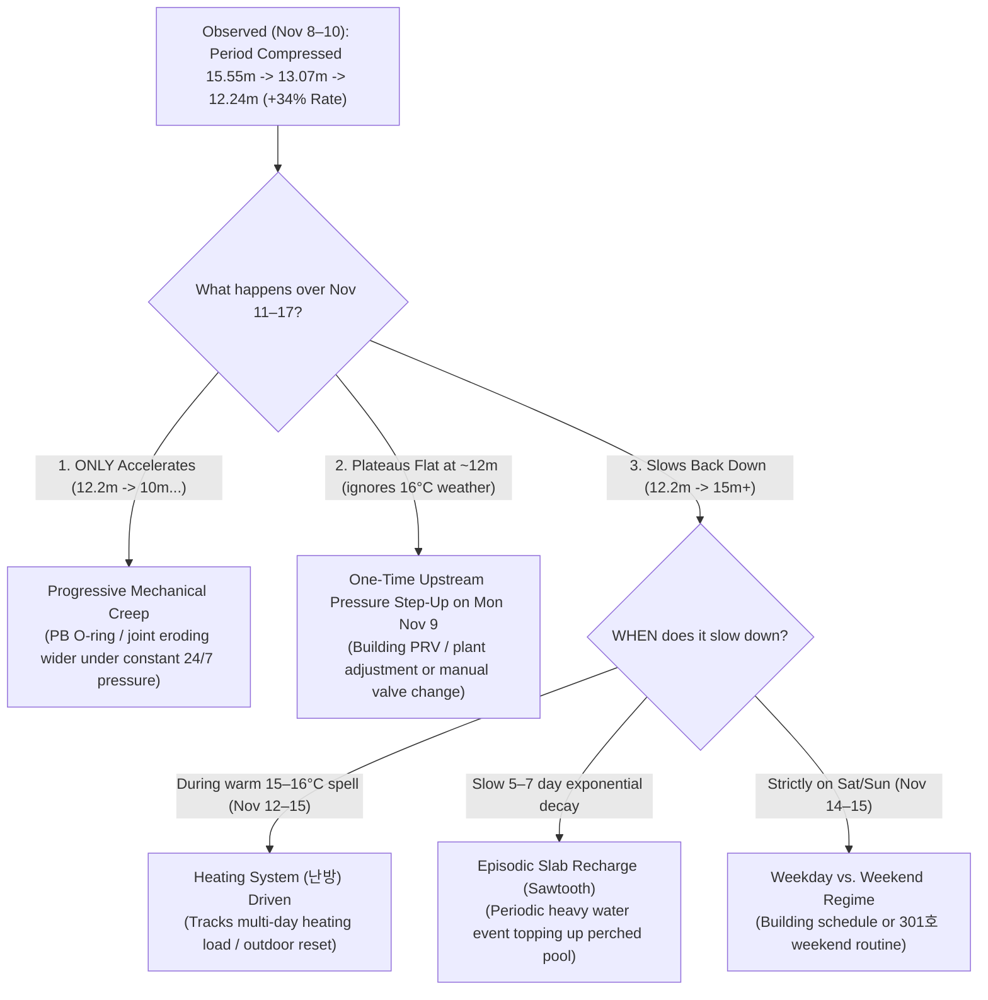

# Ceiling Leak Forensics Casefile (`1402동 201호`)

> [!IMPORTANT]
> **Current State (`Nov 8–10`, 3-Day Clean Log — `4,581 drops / 302 cycles` over `68.1h`):**
> - **Within each 24h day (`Nov 8`, `Nov 9`, `Nov 10`), the drip rate is rock-steady 24/7** (`±3%` across morning, afternoon, evening, and deep night—zero solar, thermostat, or shower/lifestyle dips/spikes).
> - **Across the 3 days, the leak accelerated by +27% (`+34%` in drops/hr):** Siphon cycle period compressed from **`15.55 min` (`Sun Nov 8`) $\to$ `13.07 min` (`Mon Nov 9`) $\to$ `12.24 min` (`Tue Nov 10`)**, while the ceiling pocket dumps a constant **`15.0 median drops/burst` (`~0.75 mL`)**.
> - **Drop Strength (`PeakADC` / `EnvPeak`) Also Stepped Up on `Nov 10` (Setup Untouched):** With zero physical movement of the sensor/box, median `PeakADC` jumped **`+38%` (`151 → 211`)** and `EnvPeak` jumped **`+24%` (`21.0 → 26.0`)** starting `Mon Nov 9 20:45`—meaning the higher flow rate wetted a wider patch at the ceiling exit and is detaching **~24% heavier drops**, making the true volumetric increase **`~+66%` (`~61 mL/day` on Sun $\to$ `~101 mL/day` pace on Tue)**.

---

## 1. Prime Candidates & Next-Observation Decision Tree

### A. Active Prime Candidates (Ranked)

| Rank | Candidate Source | Physical Mechanism | Why It Fits `Nov 8–10` (Months-Old + 24/7 Flat Profile) | How to Confirm / Isolate |
| :---: | :--- | :--- | :--- | :--- |
| **#1** | **Always-Pressurized Domestic Cold Supply (`직수/냉수 배관`) or Unvalved Main Heating Header (`온수분배기 정압부`)** | Micro-weep in a 15-year-old `PB 에이콘` O-ring / brass compression fitting under constant 24/7 static pressure (`~2.8–3.0 bar`), weeping into the under-styrofoam slab layer (`완충재 하부`). | Explains **months of continuous 24/7 flow** with **zero hourly/diurnal modulation**, and why a 20-minute `누수탐지` air test missed a `~3–4 mL/hr` (`0.05–0.06 mL/min`) weep. | **1)** Rate stays insensitive to the `Nov 12–15` warm spell (`15–16°C`). **2)** **6–8h Overnight Valve Shutoff** in `301호` stretches cycle period ($P(t) > 15\text{–}18\text{m}$) after slab lag. |
| **#2** | **Building District-Heating System (`지역난방 배관/분배기`) Buffered by High-Inertia Slab ($\tau \ge 24\text{h}$)** | Weep on `301호`'s heating manifold/coil where the saturated slab smooths out short room-thermostat cycles, so only **multi-day changes** in building supply differential pressure (`차압`) or multi-day heating load change the slab head $h(t)$. | Explains zero sub-day variation across `Nov 8–10`, while a Monday (`Nov 9`) step-up in building heating supply pressure or multi-day heating duty increased flow from `57/h` (`Sun`) to `70–76/h` (`Mon–Tue`). | **1)** Rate **slows back down (`12.2m → 15m+`)** during the warm **`15–16°C` stretch (`Thu Nov 12 – Sun Nov 15`)**. **2)** Check with `관리사무소 기전실` if heating supply pressure/temp was stepped up on `Mon Nov 9`. |
| **#3** | **Long-Time-Constant Perched Slab Pool ($\tau \approx 7\text{–}14\text{ days}$) With Multi-Day Recharge** | Large perched water pocket (`~500–1,000 mL`) trapped under `301호`'s styrofoam (`층간소음 완충재`) that drains at `~3–4 mL/hr` into a ceiling `CD관` conduit and gets topped up by episodic heavy water events (e.g., Sunday night bulk laundry, floor washdown, or rain/balcony seepage). | A reservoir with a `~10-day` time constant looks completely flat over 24 hours, jumps `+25–30%` in head after a Sunday night (`Nov 8 → Nov 9`) recharge, and then bleeds down slowly over a week. | Cycle period follows a **sawtooth curve**: jumps fast (`~12m`) after a recharge event, then **decays slowly (`12.2m → 13.5m → 15.5m`)** over 4–7 dry days. |

---

### B. The Next Line of Reasoning: Will It Only Accelerate, or Also Slow Down?

So far (`Nov 8 → Nov 10`) we have only observed an acceleration (`15.55m → 13.07m → 12.24m`). What happens over the next 4–7 days (`Wed Nov 11 – Tue Nov 17`, which includes a **`+10°C` warming wave on `Thu–Sun` up to `15–16°C`**) directly separates the remaining candidates:

| Trajectory Observed Next | Physical Implication | What It Eliminates |
| :--- | :--- | :--- |
| **A1. Continues Accelerating (`12.2m → 10m → 8m`)** | **Active Joint/Seal Creep:** The defect itself is physically enlarging under constant static pressure (`직수/냉수` or main header). Requires prompt valve isolation. | Rules out stable equilibrium seepage or weather cycles. |
| **A2. Plateaus Flat at `~12.0m` (Through Warm `16°C` Days & Weekend)** | **Step-Change in Constant Supply Pressure:** The leak orifice is fixed, and an upstream pressure regulator, building booster/heating pump, or manual valve shifted to a new steady state on `Mon Nov 9`. | Rules out weather/heating-load modulation and episodic recharge. |
| **B1. Slows Down (`12.2m → 15m+`) During `Nov 12–15` Warm Spell (`15–16°C`)** | **Multi-Day Heating (`난방`) Modulation:** The slab buffer filters out 24h swings but tracks multi-day heating duty or district-heating outdoor-reset supply pressure (`외기온도 보상 제어`). | Rules out domestic cold water (`직수/냉수`). |
| **B2. Slows Down Gradually Over 4–7 Dry Days (`Sawtooth Decay`)** | **Episodic Recharge of a Large Slab Pool ($\tau \approx 1\text{–}2\text{ wks}$):** The `Nov 8 → Nov 9` speedup was a batch recharge raising perched head $h(t)$, which then bleeds down slowly over the week. | Rules out a purely steady pressurized pinhole. |
| **B3. Slows Down Specifically on `Sat/Sun Nov 14–15`** | **Weekday vs. Weekend Regime:** Either building plant pressure or `301호`'s multi-day occupancy/zone pattern shifts on weekends. | Rules out pure unmodulated pipe creep. |

---

### C. To-Investigate Action List
- [ ] **1. Passive Observation (`Wed Nov 11 – Sun Nov 15` Warm Spell):** Let DripMeter run through the `15–16°C` warming wave and weekend to see which branch (`A1`, `A2`, `B1`, `B2`, `B3`) the `12.2 min` period takes.
- [ ] **2. Track Drop Strength (`PeakADC` / `EnvPeak`) Alongside Cycle Period:** Watch whether `PeakADC` (`~211`) and `EnvPeak` (`~26`, which eased slightly to `22–23` late Tuesday afternoon `16:00–19:00`) rise and fall in lockstep with the drip rate (confirming heavier pendant drops from a wider wetted lip at higher inflow) or stay permanently shifted.
- [ ] **3. Quick `관리사무소 기전실` (Mechanical Room) Check:** Ask if building district-heating differential pressure/supply temperature (`지역난방 공급 차압/온도`) or domestic booster pump settings were adjusted on **Monday (`Nov 9`)**.
- [ ] **4. Targeted Multi-Hour Valve Isolation in `301호` (When Ready for Next Physical Test):** Because a 20-minute shutoff cannot drain the saturated slab buffer, close **one system at a time for `6–8 hours`** while DripMeter watches whether the cycle period stretches past `15–18 min`:
  - *Test 1:* Close `301호`'s under-sink **heating manifold main supply & return valves (`온수분배기 메인 밸브`)** for 6–8 hours.
  - *Test 2:* Close `301호`'s **domestic water meter valve (`수도계량기 앵글밸브`)** overnight (`00:00–06:00`).

---

## 2. Eliminated Hypotheses

| Eliminated Hypothesis | Reason for Elimination (Empirical Proof from `Nov 8–10` Clean Log) |
| :--- | :--- |
| **1. Unbuffered Sanitary Drain / Sewer Pipe (`오·배수관 직결 누수`)** | **Never stops overnight:** Logged 84 full siphon cycles across `00:00–06:00` deep night over `Nov 8–10` (`58.0–72.5 drops/hr` continuously through 4 AM). |
| **2. Room-Thermostat / Daytime Solar-Gain Daily Shutoff** | **Zero midday dip on `Nov 8`, `Nov 9`, or `Nov 10`:** Whether overcast (`Sun Nov 8`, `8°C`) or clear & sunny (`Tue Nov 10`, `-1°C → 10°C`), afternoon (`12:00–18:00`) drop rates (`58.5/h`, `73.2/h`, `77.2/h`) match overnight/morning rates within `±3%`. |
| **3. Direct Daily Lifestyle / Shower / Appliance Spikes** | **Zero 24-hour diurnal cycle:** Across `Nov 8–10`, 6-hour drop counts (`00–06h`, `06–12h`, `12–18h`, `18–24h`) are flat all day and night—no morning or evening household usage spikes. |
| **4. Upstream Periodic Pump Cycling Every 12–16 Minutes** | **Proven local capillary siphon:** Wait time *after* a burst correlates with how many drops drained in that burst (`r = +0.463`), while burst size has near-zero correlation with wait time *before* it (`r = +0.075`). The 12–16 min rhythm is generated locally by a **`15.0-drop` (`~0.75 mL`) capillary pocket** at the ceiling exit. |

---
---

## Appendix: Supporting Data (`Nov 8–10`), Physical Models & Weather Log

### Appendix A. 3-Day Clean Telemetry Summary (`data/drops-11-10.csv`: `Nov 8 00:00` → `Nov 10 20:05`)

#### 1. Daily Siphon Cycle Evolution (`4,581 Drops`, `302 Primary Cycles` Across `Nov 8–10`)

| Date | Total Drops (Rate) | Daily Volume | Siphon Cycles | Median Period $P(t)$ | Silence Gap | Median Drops / Burst | Onset `dt1` (`#1→#2`) |
| :--- | :---: | :---: | :---: | :---: | :---: | :---: | :---: |
| **Sun `11-08`** *(24.0h)* | `1,367` (`57.0/h`) | `68.4 mL/day` | `94` | **`15.55 min`** (`15.38m` mean) | `13.32 min` | **`15.0`** (`14.6` mean) | `2.46s` |
| **Mon `11-09`** *(24.0h)* | `1,682` (`70.1/h`) | `84.1 mL/day` | `110` | **`13.07 min`** (`12.97m` mean) | `10.79 min` | **`15.0`** (`15.3` mean) | `2.09s` |
| **Tue `11-10`** *(20.1h)* | `1,532` (`76.3/h`) | **`91.6 mL/day`** *(pace)* | `98` | **`12.24 min`** (`12.20m` mean) | **`9.97 min`** | **`15.0`** (`15.4` mean) | **`2.02s`** |

#### 2. 6-Hour Window Trajectory (`Nov 8 00:00` → `Nov 10 20:05`)

| 6-Hour Window | Drops | Rate (`/hr`) | Siphon Cycles | Median Period $P(t)$ | Mean Core Drops/Cycle | Median `PeakADC` | Median `EnvPeak` |
| :--- | :---: | :---: | :---: | :---: | :---: | :---: | :---: |
| `11-08 00:00–06:00` | `348` | `58.0` | `23` | `15.58m` | `14.74` | `149` | `19.0` |
| `11-08 06:00–12:00` | `323` | `53.8` | `22` | `16.29m` | `14.36` | `155` | `20.0` |
| `11-08 12:00–18:00` | `351` | `58.5` | `25` | `15.07m` | `13.96` | `155` | `20.0` |
| `11-08 18:00–24:00` | `345` | `57.5` | `24` | `15.48m` | `14.25` | `151` | `21.0` |
| `11-09 00:00–06:00` | `404` | `67.3` | `26` | `13.84m` | `15.19` | `149` | `21.0` |
| `11-09 06:00–12:00` | `420` | `70.0` | `27` | `13.60m` | `15.15` | `149` | `22.0` |
| `11-09 12:00–18:00` | `439` | `73.2` | `28` | `12.83m` | `15.21` | `149` | `22.0` |
| `11-09 18:00–24:00` | `419` | `69.8` | `29` | `12.55m` | `14.10` | `165` | `24.0` |
| `11-10 00:00–06:00` | `435` | `72.5` | `29` | `12.25m` | `14.76` | `201` | `26.0` |
| `11-10 06:00–12:00` | `469` | `78.2` | `30` | `12.33m` | `15.43` | `222` | `27.0` |
| `11-10 12:00–18:00` | `463` | `77.2` | `30` | `12.16m` | `15.27` | `211` | `24.0` |
| `11-10 18:00–20:05` *(2.1h)* | `165` | `78.9` | `10` | `11.89m` | `14.80` | `201` | `23.0` |

#### 3. Intra-Burst Drainage Speedup (`Sun Nov 8` vs. `Mon/Tue Nov 9–10`)
Because the continuous inflow $Q_{\text{in}}$ into the ceiling pocket increased on `Mon/Tue`, it partially replenishes the pocket even during the ~2-minute burst drainage ($Q_{\text{net\_drain}} = Q_{\text{out}}(h) - Q_{\text{in}}$), shortening every inter-drop interval inside the burst:
- **Drop `#1 → #2`:** `2.46s` (`Sun`) $\to$ **`2.03s`** (`Mon/Tue`, `-17.4%`)
- **Drop `#5 → #6`:** `4.18s` (`Sun`) $\to$ **`3.93s`** (`Mon/Tue`, `-6.0%`)
- **Drop `#13 → #14`:** `16.18s` (`Sun`) $\to$ **`13.10s`** (`Mon/Tue`, `-19.0%`)

#### 4. Drop Impact Strength Profile (`PeakADC` & `EnvPeak` Step-Up After `Mon 11/09 20:45`)

| Drop Position in Burst | Before `11/09 20:45` (`ADC / Env`) | After `11/09 20:45` (`ADC / Env`) | Change (`ADC / Env`) | Physical Note |
| :---: | :---: | :---: | :---: | :--- |
| **Drop `#1` (Trigger Drop)** | **`181.0` / `21.0`** | **`261.0` / `28.0`** | **`+44%` / `+33%`** | Heaviest drop; breaks static meniscus at full head $V_{\max}$. |
| **Drops `#2 – #12` (Mid-Burst)** | `151.0` / `21.0` | `211.0` / `26.0` | `+38%` / `+24%` | Steady main-drainage drops (`~20%` heavier energy on Tue). |
| **Drops `#13 – #15` (Tail Drops)** | `142.5` / `20.0` | `191.0` / `24.0` | `+34%` / `+20%` | Lightest drops as siphon pocket approaches $V_{\min}$. |

---

### Appendix B. Physical System Model & Building Facts

1. **Building Context (`산운마을 14단지 경남아너스빌 1402동 201호`, ~2009 Construction):**
   - **`201호` (Your Unit):** Floor heating is completely **OFF**.
   - **`301호` (Upstairs):** Occupied by an older Korean couple; floor heating is running.
   - **Pre-Metering Tests:** Short water shutoffs did not immediately stop drips; initial `누수탐지 팀` short pressure/acoustic tests found no obvious rupture.
2. **Two-Stage Hydraulic Model:**
   $$\text{Upstream Weep } Q_{\text{in}}(t) \;\xrightarrow{\text{Saturated Slab Buffer (Head } h(t)\text{)}}\; \text{Capillary Siphon ($\Delta V_{\text{siphon}} \equiv 15\text{ drops}$)} \;\xrightarrow{}\; \text{Cycle Period } P(t) = \frac{\Delta V_{\text{siphon}}}{Q_{\text{exit}}(h(t))}$$
3. **Why the First `누수탐지 팀` Missed It (Checklist for Next Inspection):**
   - At `68–92 mL/day` (`0.05–0.06 mL/min`), a 20-minute static pressure test loses `< 1.3 mL`—invisible on standard `±0.05 bar` gauges and silent to acoustic stethoscopes (`청음기`).
   - **Target #1 (`301호` Under-Sink Heating Manifold `싱크대 하부 온수분배기`):** Inspect air vent (`에어핀`), actuator stems (`구동기`), and brass compression nuts for a slow weep trickling down the **unsealed floor pipe-sleeve cutout (`슬리브 틈새`)** below the styrofoam layer.
   - **Target #2 (`15-Year-Old PB Fittings / 에이콘 부속`):** Hardened PB O-rings can seal tightly under `6–8 bar` high-pressure air tests (`고압 불감지 누수`) while weeping at normal `2.5–3 bar` operating pressure.

---

### Appendix C. KMA Weather Reference (`성남시 분당구 운중동 37.38, 127.07`, Also in `data/kma_hourly.csv`)

- **Sun Nov 8 (`8일 일`):** Overcast (`흐림`), **`1°C / 8°C`**, light rain `~1mm` at `19–21h` (`P_med = 15.55m`, `57.0 drops/h`)
- **Mon Nov 9 (`9일 월`):** Cloudy AM / Sunny PM (`14h~`), **`4°C / 10°C`** (`P_med = 13.07m`, `70.1 drops/h`)
- **Tue Nov 10 (`10일 화`):** Clear (`맑음`), **`-1°C / 10°C`** (`P_med = 12.24m`, `76.3 drops/h`)
- **Upcoming Warm Spell (`Wed Nov 11 – Sun Nov 15`):**
  - **Wed Nov 11:** `2°C / 13°C` (Cloudy AM, Sunny PM)
  - **Thu Nov 12:** `3°C / 15°C` (Sunny)
  - **Fri Nov 13:** `6°C / 15°C` (Sunny)
  - **Sat Nov 14:** `7°C / 16°C` (Cloudy AM, Rain PM)
  - **Sun Nov 15:** `11°C / 15°C` (Overcast)
  - **Mon Nov 16 – Tue Nov 17:** `8°C / 13°C` → `5°C / 13°C`
