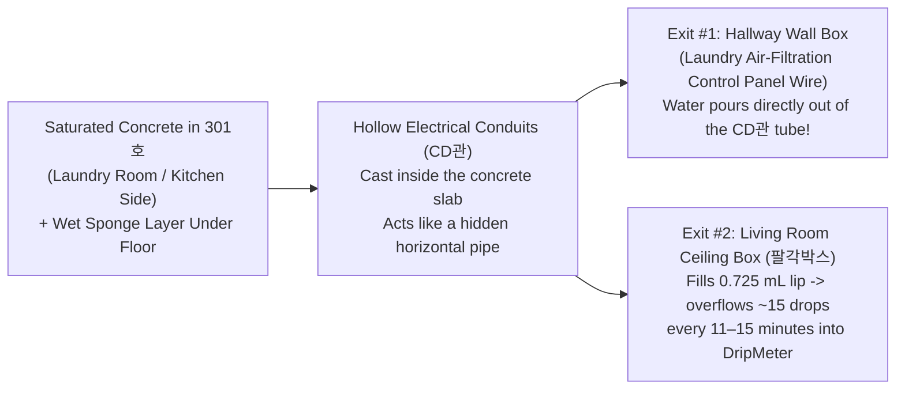

# Ceiling & Wall Leak Investigation Report (`산운마을 14단지 1402동 201호`)

> **Purpose of this document:** Written from **first principles in plain language (zero technical background required)** for the Building Management Office (`관리사무소 / 기전실`), Unit 301 (`301호`), and Leak Detection Specialists (`누수탐지 업체`).
> - **The Core Goal:** We are at the stage where opening the floor ("exploratory surgery") in the suspect area may be needed—and understandably, **nobody wants to break concrete without proof**. This document connects the physical evidence, the 7-day sensor measurements (`Nov 8–14`), and the `44B` (`146.49㎡B`) layout to show **why the saturated Laundry Room (`다용도실`) area is the prime suspect**, **why we need the building's Electrical Conduit (`CD관`) & Plumbing blueprints first**, and **how to prove 100% on paper and with non-destructive tests that these areas are connected before anyone touches a hammer.**

---

## 1. Starting From First Principles: What Is Happening in Unit 201?

### A. Two Leak Exits + One Known Wet Spot Upstairs (Active Since March/April 2026)
Since spring 2026 (over 7 months, through spring, summer, and autumn), water has been showing up in three linked places:
1. **Known Wet Area Upstairs (`301호` Laundry / Utility Room `다용도실 / 세탁실`):** The concrete floor around the laundry room on the side of the kitchen in `301호` has been reported to look **visibly saturated and wet**. That laundry room also houses the apartment's **whole-house air filtration / ventilation unit (`전열교환기 / 세대 환기유니트`)** connected to the outside.
2. **Exit #1 in `201호` — Hallway / Kitchen Wall (`주방 옆 복도 벽면`):** Directly on the wall outside the kitchen/laundry area, water is pouring out of a **white ribbed plastic electrical conduit (`CD 전선관`)** into a catch bottle. **Crucially, this exact conduit carries the control wire for the Laundry Room Air Filtration System (`환기시스템 벽면 조절기`)!**
3. **Exit #2 in `201호` — Living Room Ceiling (`거실 천장`):** A few meters away in the living room (in front of the TV wall), water drips out of a **round metal electrical junction box (`팔각 아웃렛 박스`)** cast into the bottom of the concrete ceiling slab.

### B. How Water Travels From the Laundry/Kitchen Side to the Living Room Ceiling: The "Electrical Tube Highway" (`CD전선관 통로`)
A natural question is: *"If the wet concrete is in the laundry room / kitchen area, why is water dripping in the middle of the living room ceiling?"*

- There are **no water pipes** cast inside the structural concrete ceiling slab in the middle of the living room.
- Instead, when the building was poured (~2009), electricians laid **hollow corrugated plastic tubes (`CD 전선관`)** directly inside the concrete slab to run wires between the **Laundry Room air-filtration unit (`전열교환기`)**, the **hallway wall control panel (`환기 조절기`)**, the **electrical panel (`분전함`)**, and the **living room ceiling light boxes (`팔각박스`)**.
- When water saturates the concrete slab under `301호`'s floor insulation (`층간소음 완충재 하부`) around the laundry room / kitchen, it enters these hollow plastic `CD관` electrical tubes (or runs along their outer ribs) like a hidden underground gutter and exits at the lowest points:
  1. Down the **air-filtration control wire tube** into the hallway wall (`Exit #1`).
  2. Across the ceiling slab conduit into the **living room ceiling junction box** (`Exit #2`).

---

## 2. What 7 Days of Automated Measurement (`Nov 8 – Nov 14`) Proved — And How to Interpret the Speedup Carefully

To replace guesswork with numbers, we placed an automated drop counter (`DripMeter`) under the living room ceiling drip for **7 straight days (`Sun Nov 8 00:00` → `Sat Nov 14 12:38`, `156.6 hours`, `11,948` drops across `769` overflow cycles)** and physically measured the collected water (`85 mL` and `207 mL`).

### Fact #1: Why the Ceiling Drips in "Bursts" Every 11–15 Minutes (The "`0.725 mL` Tipping Bucket")
- Water does **not** drip randomly, and there is **no machine turning on every 12 minutes**.
- Water slowly creeps along the ceiling electrical conduit and hangs on the metal lip of the ceiling junction box by surface tension until a tiny **`0.725 mL` puddle (~15 drops)** collects.
- Once that puddle reaches **`0.725 mL`**, surface tension breaks and the entire `0.725 mL` drains out in a **90-second burst of ~15 drops** (like a tipping bucket), then stops for **11 to 15 minutes** while the next `0.725 mL` refills.
- **Physical Proof (`±1%` accuracy):**
  - **`Nov 11–12` (24.0 hours):** `119` bursts recorded = **`85 mL`** measured (**`0.714 mL / burst`**).
  - **`Nov 12–14` (52.0 hours):** `284` bursts recorded = **`207 mL`** measured (**`0.729 mL / burst`**).

### Fact #2: Within Any Single Day, the Drip Rate Is Flat 24/7 (`±3%` Day vs. 4:00 AM Night)
- On every single day measured, the drip rate between **Midnight and 6:00 AM** is identical (`within ±3%`) to the rate in the morning, afternoon, and evening.
- **Why?** Because the porous concrete and styrofoam layer under `301호`'s floor acts like a **giant wet sponge ("Slab Reservoir")**. Even if water enters the slab intermittently or fluctuates during the day, the saturated sponge holds a large pool of water on top of the concrete slab and pushes it into the electrical conduit at a steady, continuous trickle 24 hours a day.

### Fact #3: Over `Nov 8 – Nov 14`, the Volume Rose `+51.5%` (`68 mL/day → 103 mL/day`) — Why We Must Be Careful Not to Over-Interpret This Alone
Across the 7 days we measured, the time between `0.725 mL` overflows shortened each day:

| Day | Outdoor Temp (`Min / Max`) | Siphon Overflows (`Bursts/day`) | Time Between Overflows (Median Period) | **True Water Volume (`0.725 mL/burst`)** | Physical Water Measured |
| :--- | :---: | :---: | :---: | :---: | :---: |
| **Sun `Nov 8`** | `1°C / 8°C` | `94 / day` (`3.92/hr`) | **Every `15.5 min`** | **`68.1 mL / day`** | — |
| **Mon `Nov 9`** | `4°C / 10°C` | `110 / day` (`4.58/hr`) | **Every `13.1 min`** | **`79.7 mL / day`** | — |
| **Tue `Nov 10`** | `-1°C / 10°C` | `120 / day` (`5.00/hr`) | **Every `12.1 min`** | **`86.9 mL / day`** | — |
| **Wed `Nov 11`** | `2°C / 13°C` | `118 / day` (`4.92/hr`) | **Every `12.4 min`** | **`85.5 mL / day`** | **`85 mL`** (`24.0h` catch) |
| **Thu `Nov 12`** | `3°C / 15°C` | `124 / day` (`5.17/hr`) | **Every `11.9 min`** | **`89.8 mL / day`** | *(Part of 52h catch below)* |
| **Fri `Nov 13`** | `6°C / 15°C` | `128 / day` (`5.33/hr`) | **Every `11.6 min`** | **`92.7 mL / day`** | *(Part of 52h catch below)* |
| **Sat `Nov 14`** | `7°C / 16°C` | **`142 / day` pace** (`5.93/hr`) | **Every `10.8 min`** | **`103.2 mL / day` pace** | **`207 mL`** (`52.0h` catch = `205.8 mL` predicted!) |

> [!WARNING]
> **Important Caution on the Speedup (`Why Historical Context Matters`):**
> Before `DripMeter` was installed, over the past 7–8 months (March → November), **this leak has been observed to both speed up AND slow down over time** (sometimes much wetter, sometimes almost dry).
> Therefore, we **cannot** assume the `Nov 8–14` speedup (`68 → 103 mL/day`) is a one-time building pressure adjustment or a pipe permanently ripping open. Instead, several multi-day mechanisms explain why the slab reservoir rises and falls over weeks:
> 1. **Slow Filling & Draining of the Saturated Slab ("Water Table" Effect):** When more water feeds into the laundry/kitchen slab over several days, the "water level" trapped under `301호`'s floor styrofoam rises by a few millimeters, increasing the pressure pushing water into the electrical conduit (`68 → 103 mL/day`). When the input eases, that trapped pool takes days or weeks to slowly bleed back down.
> 2. **Hot-Water (`온수`) or Seasonal Heating (`난방`) Usage Volume:** If the leak is on a **hot water supply line (`온수관`), heating manifold (`분배기`), or boiler/condensate line**, colder November weather means more cumulative hot water and heating circulation over the week—thermal expansion and higher total usage feed more water into the slab reservoir even if individual hours look flat.
> 3. **Laundry Room / Air-Filtration / Drain Accumulation:** Repeated washing machine drains, condensation in the laundry room air-filtration box (`전열교환기`), or utility drain backups can top up the already-saturated laundry room concrete faster than it drains out through the ceiling conduit.

---

## 3. Looking at the `44B` (`146.49㎡B`) Layout: The Standing Hypotheses

Putting together **(a) the visibly wet concrete in `301호`'s Laundry Room**, **(b) water pouring down the Laundry Room Air-Filtration control panel conduit (`Exit #1`)**, and **(c) the steady 24/7 siphon in the Living Room ceiling (`Exit #2`)**, here are the **standing hypotheses** ranked by how directly they connect all three:

| Priority | Standing Hypothesis | Scope (`301호` vs. Common) | Physical Connection on the `44B` (`146.49㎡B`) Layout | Why It Explains All Observations (`March–Nov` Waves + Wet Laundry Floor + Wall/Ceiling Exits) |
| :---: | :--- | :---: | :--- | :--- |
| **#1 (Prime Suspect Zone)** | **Leak in `301호`'s Laundry / Utility Room (`다용도실 / 세탁실`) or Adjacent Kitchen Wall** *(Washing machine supply tap/pipe `세탁기 수전/냉·온수관`, Air-Filtration unit condensation/drain `전열교환기 결로/드레인`, or Laundry floor drain sleeve `세탁실 배수 유가 방수 틈새`)* | **Unit 301 (`301호`)** *(or Exterior Louver/Shaft)* | Side of the **Kitchen (`주방/식당`) / Utility Balcony (`발코니1/다용도실`)**, directly connected by electrical conduit to the **Hallway Air-Filtration Control Panel (`Exit #1`)** and adjacent to the **Living Room (`거실`)**. | • **Direct physical match:** `301호`'s concrete floor around this laundry area is **already reported wet/saturated**, and `Exit #1` in `201호` is **literally the electrical conduit for the laundry room's air-filtration control panel**! • Explains why the leak has been active **since March/April (spring & summer)** AND why its volume **rises and falls over weeks** as the laundry room concrete slab saturates and drains. |
| **#2** | **`301호` Hot or Cold Domestic Water Pipe (`온수·냉수 급수배관`) or Under-Sink Heating Manifold (`주방 싱크대 하부 온수분배기`)** | **Unit 301 (`301호 전용`)** | Runs through the hallway/kitchen wall right between the **Kitchen Sink (`싱크대`)** and the **Laundry Room (`다용도실`)**. | • The kitchen sink and laundry room share the exact same plumbing wall. • A micro-leak on a **hot water (`온수`) PB fitting** or **under-sink heating manifold (`온수분배기` / floor sleeve `슬리브 틈새`)** naturally saturates the adjacent laundry/kitchen floor slab first, and fluctuates seasonally as hot water / heating usage increases in autumn/winter. |
| **#3** | **Vertical Common Pipe Shaft (`PD / 비트`) Riser or Drain Stack (`아파트 공용 비트 내 수직 입상관`)** | **Building Common (`관리사무소 / 공용부`)** | Vertical pipe shafts (`PD 비트` hatched boxes on the `44B` plan) behind the **Kitchen / Laundry wall** and behind **`욕실2` (Master Bath / Living Room TV wall)**. | • If a common vertical riser (`급수/온수/난방 입상관`) or vertical drain/vent stack inside the utility/kitchen shaft weeps onto the `301호` slab deck, it saturates the laundry/kitchen concrete continuously **even if `301호`'s unit valves are closed**. |

---

## 4. What We Need to Investigate Next (Proving the Connection Before Any "Exploratory Surgery")

Right now, the biggest roadblock is human: **breaking open concrete ("exploratory surgery") in `301호` is disruptive and expensive, so nobody wants to authorize it while there is any doubt about whether the wet laundry room concrete in `301호` is actually connected to the living room ceiling drip in `201호`.**

Here is the **3-Step Plan** to establish 100% undeniable proof **before** anyone opens the floor:

### Step 1 (Zero Cost, Immediate): Get the `44B` Blueprints from `관리사무소 기전실` to Prove the Conduit Connection on Paper
Go to the **Building Management Mechanical/Electrical Office (`관리사무소 기전실`)** and ask to photograph these **4 specific `44B (146.49㎡B)` As-Built Diagrams (`준공 도면`)**:

1. **① Electrical Lighting & Power Conduit Plan (`전등·전열 배관 평면도`):**
   - **What it proves:** Shows the exact cast-in-slab `CD관` plastic tube routes connecting the **Kitchen / Laundry Room (`주방/다용도실`)**, the **Hallway Switch/Control Wall (`복도 벽면`)**, and the **Living Room Ceiling Junction Box (`거실 천장 팔각박스`, `Exit #2`)**.
2. **② Ventilation / Air-Filtration Control Wiring Plan (`환기설비 / 전열교환기 배관·배선 및 제어기 도면` — often under `기계설비` or `약전/제어 도면`):**
   - **What it proves:** Shows on the official blueprint that the `CD관` tube pouring water into your wall (`Exit #1`) goes **directly to the Laundry Room Air-Filtration Unit (`다용도실 전열교환기`)** where `301호`'s concrete is wet!
3. **③ Domestic Cold/Hot Water & Heating Piping Plan (`급수·급탕 및 난방 배관 평면도`):**
   - **What it proves:** Shows which pressurized pipes (`직수`, `온수`, `난방`) and manifolds pass through or next to the Laundry Room / Kitchen wall.
4. **④ Sanitary Drainage & Pipe Shaft Plan (`오·배수 및 비트 평면도`):**
   - **What it proves:** Shows the laundry floor drain routing and the exact location of the common vertical pipe shafts (`PD 비트`).

> **Why Step 1 is a game-changer:** Once we lay the building's own `CD관` conduit diagram on the table showing a continuous plastic tube running from the **saturated Laundry Room** $\rightarrow$ **Hallway Wall Control Panel (`Exit #1`)** $\rightarrow$ **Living Room Ceiling Box (`Exit #2`)**, nobody can claim the living room ceiling drip is "unrelated" to the wet laundry room concrete!

---

### Step 2 (Zero Demolition): How to Separate `301호` Pipes vs. Laundry Drain vs. Building Common Pipes (`공용부`)

Before anyone chips concrete in `301호`'s laundry room or kitchen, we can narrow down *which* pipe in that area is feeding the slab using non-destructive tests while `DripMeter` logs the ceiling and we watch the wall bottle:

1. **Non-Destructive Visual & Endoscope Check in `301호`'s Laundry Room & Kitchen Sink (`육안 + 내시경 점검`):**
   - **Inside `301호` Laundry Room (`다용도실`):**
     - Check the **Air Filtration Unit (`전열교환기`)** ceiling/wall box and its condensate/exterior ducts—is water pooling inside the unit or entering its electrical conduit box?
     - Check the **Washing Machine faucets (`세탁기 냉·온수 수전`)** and wall connection threads for slow weeping down the wall into the concrete floor.
     - Inspect the **Laundry Floor Drain collar (`바닥 배수 유가`)**—is the grout/waterproofing around the plastic drain pipe cracked so water seeps under the tile?
   - **Under `301호` Kitchen Sink (`싱크대 하부장` — right next to the laundry room wall):**
     - Open the bottom kickplate under the kitchen sink and press dry tissue against the **heating manifold (`온수분배기`)** joints and the **floor pipe sleeve cutout (`바닥 배관 슬리브 틈새`)**.
2. **Overnight Valve Isolation Tests (`심야 6~8시간 밸브 차단 테스트` — `301호` vs. Common Area `공용부`):**
   - Because the wet concrete slab acts like a slow sponge, shutting a valve for 20 minutes does nothing—but shutting it for **6–8 hours overnight (`00:00–06:30`)** while `DripMeter` records every overflow (`currently every 10.8 min`) will show if the slab pressure drops:
     - **Night 1:** Turn OFF `301호`'s **Hallway Water Meter (`수도계량기 냉수 + 온수 밸브`)** from `00:00–06:30`. If the `10.8 min` interval stretches out (`→ 15–25+ min`) and the wall bottle slows down, it is **100% a pressurized `301호` Cold/Hot Supply Pipe (`냉·온수 배관`)** in that kitchen/laundry zone.
     - **Night 2:** Turn OFF `301호`'s **Under-Sink Heating Main Valves (`싱크대 밑 난방 메인 공급·환수 밸브`)** for 6–8 hours. If the interval stretches out, it is **100% on `301호`'s heating manifold/coil**.
     - **What if NEITHER valve test slows the drip after 6–8 hours?** Then `301호`'s pressurized supply & heating pipes are **not** the source—meaning the water saturating the laundry room concrete is coming from either **Apartment Common Infrastructure (`공용 PD 비트 입상관 / 외벽 루버`)**, the **Air-Filtration unit / condensate**, or a **large trapped pool under the laundry room floor fed by the laundry drain (`세탁실 배수 유가 방수 불량`)**!

---

### Step 3: If We Bring In the `누수탐지` (Leak Detection) Crew — 5 Specific Things to Have Them Do

If a `누수탐지` specialist comes out, **do NOT let them just hook an analog air gauge to the pipes for 20 minutes and leave.** At `103 mL/day` (`0.07 mL/min` = `1.4 mL` in 20 minutes), a standard 20-minute dial gauge test (`±0.05 bar`) and stethoscope (`청음기`) will miss it 100% of the time.

Ask the `누수탐지` crew to focus specifically on these **5 tasks**:

1. **Task #1 — Trace the Open Conduit (`CD관`) From Our Wall (`Exit #1`) & Ceiling (`Exit #2`) Back to the Laundry Room:**
   - Have them use an **electrician's fish tape / endoscope (`요비선 / 내시경`)** or **thermal + moisture scanner (`열화상 카메라 + 수분측정기`)** starting directly at the open **Air-Filtration Control Panel conduit in the hallway wall (`Exit #1`)** and the **Living Room Ceiling box (`Exit #2`)** to prove physically that the water inside the tube leads straight back to the wet concrete in `301호`'s Laundry Room (`다용도실`)!
2. **Task #2 — Inspect `301호` Laundry Room (`다용도실`) & Under-Sink Manifold (`싱크대 하부`) Before Pressurizing Anything:**
   - Check the laundry room floor concrete moisture, the air-filtration unit (`전열교환기`), washing machine supply taps, laundry drain sleeve (`유가`), and under-sink heating manifold floor sleeve (`싱크대 밑 바닥 슬리브 틈새`) first.
3. **Task #3 — Inspect the Vertical Common Pipe Shafts (`PD 비트`) With an Endoscope (`내시경 카메라`):**
   - Check inside the pipe shaft behind the Kitchen/Laundry wall and behind `욕실2` (Master Bath / TV wall) to rule out a common riser weep (`아파트 공용 입상관 누수`).
4. **Task #4 — If Pressure Testing `301호`'s Pipes (`냉수 / 온수 / 난방`), Use a `0.001 bar` Digital Manometer for 60+ Minutes at Both `3 bar` and `6 bar`:**
   - 15-year-old **`PB (에이콘)` rubber O-ring fittings** often seal shut when pumped to `7 bar` high air pressure (`고압 불감지 현상`) and only weep at normal `2.5–3.0 bar` operating pressure (or when hot water expands the fitting!). Test `직수 (Cold)`, `온수 (Hot)`, and `난방 (Heating)` separately for at least 60 minutes with a precision digital gauge.
5. **Task #5 — Use Tracer Gas (`수소/헬륨 추적 가스`) or Fluorescent Dye (`형광 염료`) for Final Pinpointing Before Breaking Concrete:**
   - Before jackhammering `301호`'s laundry room floor:
     - If it's a pressurized pipe, inject **hydrogen/helium tracer gas (`추적 가스`)** and sniff right at `301호`'s laundry/kitchen floor and `201호`'s open wall `CD관` (`Exit #1`).
     - If it's suspected to be the laundry room floor drain / waterproofing (`세탁실 배수구/방수`), pour water with **fluorescent UV dye (`형광 테스트 염료`)** into `301호`'s laundry drain/floor and check with a UV flashlight if the dye appears in `201호`'s wall bottle (`Exit #1`)!

---
---

## 5. Eliminated Hypotheses (Ruled Out by the 7-Day Data)

| Eliminated Hypothesis | Why It Is Ruled Out (Plain-English Proof from `Nov 8–14` Data) |
| :--- | :--- |
| **1. Direct Unbuffered Toilet / Bathroom Drain Pipe (`완충층 없는 오·배수관 직결 누수`)** | **Never stops overnight:** A direct pipe drip from a toilet or shower drain stops when nobody is using water at 4:00 AM. Here, water first pools in the concrete/styrofoam slab reservoir and drains continuously 24/7 (`769` bursts across 7 days, flat within `±3%` day and night). |
| **2. Direct Hourly Shower or Appliance Spikes (`시간대별 생활용수 피크`)** | **Zero morning or evening peaks within any 24h day:** The slab reservoir completely smooths out hour-by-hour activity into a steady 24-hour flow. |
| **3. An Appliance Pump Turning On Every 12 Minutes (`12분마다 도는 펌프/기계`)** | **Proven natural ceiling siphon (`0.725 mL` tipping bucket):** Both physical water measurements (`85 mL / 119 bursts = 0.714 mL` and `207 mL / 284 bursts = 0.729 mL`) and inter-drop physics (`r = +0.463`) prove the 11–15 minute cycle is simply the `0.725 mL` ceiling box lip filling up and overflowing. |

---
---

## Appendix: Technical Telemetry Tables (`Nov 8 – Nov 14`, `156.6 Hours`)

### A. 7-Day Daily Siphon & Volumetric Summary ([data/drops-master-11-08_to_11-14-clean.csv](file:///Users/bartjarochowski/Dev/AntigravityProjects/DripMeter/data/drops-master-11-08_to_11-14-clean.csv))

| Date | Hours Logged | Siphon Bursts | Bursts / hr | Median Period $P(t)$ | Clean Drops (`Drops/hr`) | Median Drops / Burst | Median `PeakADC` (`EnvPeak`) | Calibrated Volume (`0.725 mL/burst`) | Measured Water Catch |
| :--- | :---: | :---: | :---: | :---: | :---: | :---: | :---: | :---: | :--- |
| **Sun `11-08`** | `24.0h` | `94` | `3.92/h` | **`15.51 min`** | `1,367` (`57.0/h`) | `15.0` | `151` (`20.0`) | **`68.1 mL/day`** | — |
| **Mon `11-09`** | `24.0h` | `110` | `4.58/h` | **`13.11 min`** | `1,682` (`70.1/h`) | `15.0` | `151` (`22.0`) | **`79.7 mL/day`** | — |
| **Tue `11-10`** | `24.0h` | `120` | `5.00/h` | **`12.10 min`** | `1,815` (`75.6/h`) | `15.0` | `207` (`25.0`) | **`86.9 mL/day`** | — |
| **Wed `11-11`** | `24.0h` | `118` | `4.92/h` | **`12.41 min`** | `1,601` (`66.7/h`) | `13.0` | `131` (`17.0`) | **`85.5 mL/day`** | **`85 mL`** (`11/11 07:22 → 11/12 07:30`, `24.0h`, `119 bursts`) |
| **Thu `11-12`** *(clean)* | `24.0h` | `124` | `5.17/h` | **`11.87 min`** | `1,916` (`79.8/h`) | `16.0` | `137` (`21.0`) | **`89.8 mL/day`** | *(Part of 52.0h catch below)* |
| **Fri `11-13`** | `24.0h` | `128` | `5.33/h` | **`11.55 min`** | `2,261` (`94.2/h`) | `17.0` | `179` (`27.0`) | **`92.7 mL/day`** | *(Part of 52.0h catch below)* |
| **Sat `11-14`** *(to 12:38)* | `12.6h` | `75` | **`5.93/h`** | **`10.75 min`** | `1,306` (`103.3/h`) | `17.0` | `199` (`29.0`) | **`103.2 mL/day`** *(pace)* | **`207 mL`** (`11/12 07:30 → 11/14 11:38`, `52.0h`, `284 bursts` = `205.8 mL` model!) |

### B. Physical Volume Calibration (`85 mL` vs. `207 mL`) & Tub Placement Epochs

| Placement Epoch | Time Window (`Duration`) | Median `PeakADC` (`EnvPeak`) | Siphon Bursts (`Rate`) | Median Period $P(t)$ | Median Drops / Burst | Measured Volume | Volume / Burst (`Volume / Drop`) |
| :--- | :--- | :---: | :---: | :---: | :---: | :---: | :---: |
| **Epoch 1** (`Nov 8–9`) | `11/08 00:00 → 11/09 20:45` (`44.8h`) | `151` (`21.0`) | `190` (`4.25/h`) | `14.12m` | `15.0` | — | `~0.725 mL` *(est)* |
| **Epoch 2** (`Nov 9–11`) | `11/09 20:45 → 11/11 07:22` (`34.6h`) | `207` (`25.0`) | `172` (`4.97/h`) | `12.12m` | `15.0` | — | `~0.725 mL` *(est)* |
| **Epoch 3 (`11/12 Catch`)** | **`11/11 07:22 → 11/12 07:30` (`24.00h`)** | **`127` (`16.0`)** | **`119` (`4.96/h`)** | **`12.35m`** | **`13.0`** | **`85.0 mL`** | **`0.714 mL/burst`** (`52.8 µL/drop`) |
| **Epoch 4 (`11/12 Low-SNR`)** | `11/12 07:30 → 11/12 18:45` (`11.25h`) | `135` (`23.0` clean) | `57` (`5.07/h`) | `12.04m` | `16.0` | *(in 207 mL)* | **`0.729 mL/burst`** |
| **Epoch 5 (`11/12–13`)** | `11/12 18:45 → 11/13 21:00` (`26.25h`) | `179` (`27.0`) | `141` (`5.37/h`) | `11.55m` | `17.0` | *(in 207 mL)* | **`0.729 mL/burst`** |
| **Epoch 6 (`11/13–14`)** | `11/13 21:00 → 11/14 11:38` (`14.63h`) | `199` (`29.0`) | `86` (`5.88/h`) | `10.82m` | `17.0` | **`207.0 mL`** *(Epochs 4–6, `52.02h`, `284 bursts`)* | **`0.729 mL/burst`** (`42.6 µL/drop`) |
