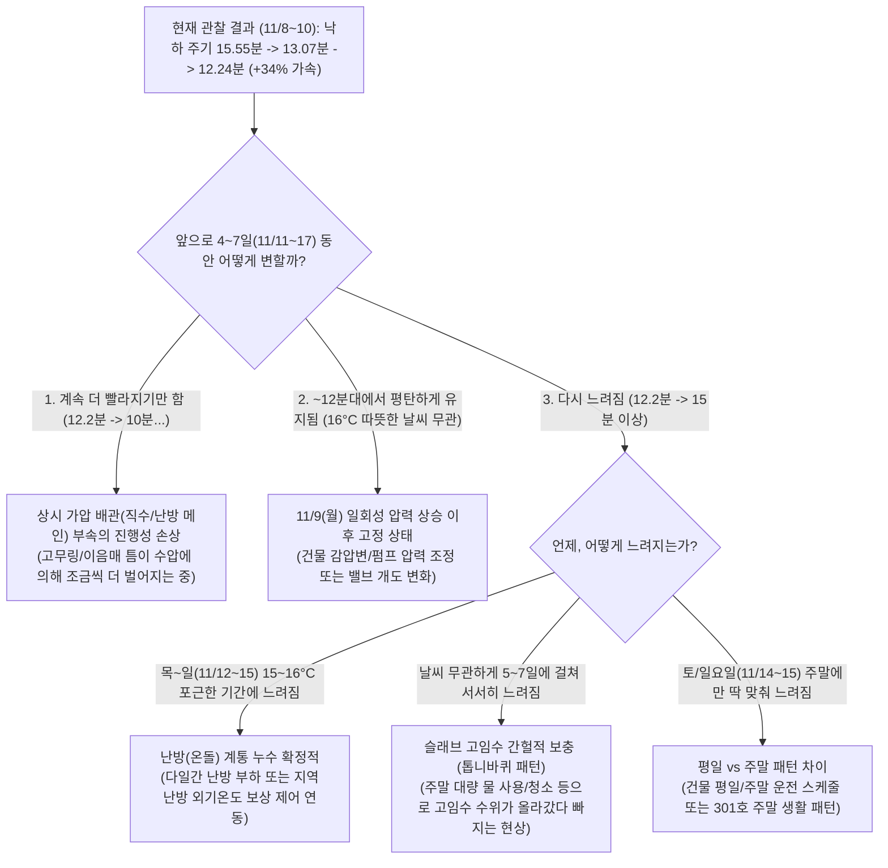

# 천장 누수 원인 분석 보고서 (`1402동 201호`)

> [!IMPORTANT]
> **현재 상황 요약 (`11월 8일 ~ 10일`, 3일간의 정밀 센서 측정 — 총 `4,581방울 / 302회 주기`, `68.1시간`):**
> - **하루(24시간) 내내 밤낮 없이 일정함:** 일요일(`11/8`), 월요일(`11/9`), 화요일(`11/10`) 모두 새벽·아침·오후·밤 시간대별 물방울 속도가 **`±3%` 이내로 완전히 일정**합니다 (햇빛, 실내 온도조절기, 샤워·설거지 등 일상생활 시간대와 무관함).
> - **3일 사이 누수 속도가 약 +34% 빨라짐:** 한 번 물이 고였다가 떨어질 때마다 똑같이 **`약 15방울(약 0.75 mL)`**씩 쏟아지는데, 그 **주기(간격)**가 **`15.55분(일)` $\to$ `13.07분(월)` $\to$ `12.24분(화)`**으로 점점 짧아졌습니다 (`하루 약 68 mL` $\to$ `약 92 mL` 페이스).
> - **화요일(`11/10`)에는 물방울 1개당 크기(무게)도 함께 증가함 (센서 위치 이동 전혀 없음):** 센서 박스를 전혀 건드리지 않은 상태에서 `11/9(월) 밤 20:45`부터 충격 강도(`PeakADC`)가 **`+38%`(`151 → 211`)**, 에너지(`EnvPeak`)가 **`+24%`(`21.0 → 26.0`)** 상승했습니다. 즉, 유입 속도가 빨라지면서 천장 출구 젖음 면적이 넓어져 **한 방울당 무게도 약 +24% 무거워졌으며, 실제 총 누수 부피는 일요일 대비 약 `+66%` (`일요일 약 61 mL/일` $\to$ `화요일 약 101 mL/일` 페이스)** 증가했습니다.

---

## 1. 유력한 누수 원인 후보 Top 3 및 향후 관찰 판단 기준

### A. 현재 가장 유력한 누수 원인 후보 (우선순위 순)

| 순위 | 유력 후보 | 물리적 원리 (메커니즘) | 최근 3일(`11/8~10`) 데이터 및 수개월 지속 현상과 부합하는 이유 | 확인 및 검증 방법 |
| :---: | :--- | :--- | :--- | :--- |
| **1위** | **24시간 상시 가압 배관 미세 누수** (`301호` **직수/냉수 배관** 또는 **난방 온수분배기 메인 정압부**) | 15년 된 `PB(에이콘) 배관` 고무링(O-ring)이나 황동 부속 연결부에서 `2.8~3.0 bar`의 일정한 수압으로 하루 24시간 내내 미세하게(`시간당 3~4 mL`) 물이 배어 나와 바닥 스티로폼(`층간소음 완충재`) 아래로 스며드는 현상. | **수개월간 밤낮 없이 24시간 일정한 속도로 떨어지는 현상**을 가장 잘 설명하며, 분당 `0.05 mL`(`20분간 약 1 mL`) 수준이라 기존 누수탐지 팀의 단시간(20분) 공기압 검사나 청음기로는 절대 잡히지 않습니다. | **1)** 목~일요일(`11/12~15`) 포근한 날씨(`15~16°C`)에도 속도가 줄지 않고 유지됨. **2)** `301호` 밸브를 **6~8시간(야간)** 잠갔을 때 주기가 다시 `15~18분` 이상으로 늘어나는지 확인. |
| **2위** | **지역난방 배관/분배기 미세 누수** *(슬래브 완충 효과로 24시간 이상 평균화됨)* | `301호` 난방 배관이나 분배기 부속의 미세 누수이지만, 이미 물을 머금은 바닥 콘크리트/완충재 층이 댐 역할을 해서 **시간 단위의 온도조절기 켜짐/꺼짐은 평탄화**되고, **며칠 단위의 난방 공급 압력(차압)이나 날씨 변화**만 반영되는 현상. | 하루 안에서는 밤낮 차이가 없으면서도, 주말 한파 뒤 **월요일(`11/9`)부터 유입 속도가 +34% 빨라진 현상**(단지 기계실 난방 차압 조정 또는 다일간 난방 부하 누적)을 설명할 수 있습니다. | **1)** 목~일요일(`11/12~15`) 기온이 **`15~16°C`로 크게 오를 때** 주기가 다시 **`12.2분 → 15분 이상`으로 느려지는지** 관찰. **2)** 관리사무소(기전실)에 `11/9(월)` 난방 공급 압력/온도 조정이 있었는지 문의. |
| **3위** | **바닥 완충재 하부의 넓은 고임수(`고인 물 주머니`) + 간헐적 대량 보충** | `301호` 바닥 스티로폼(`층간소음 완충재`) 아래에 꽤 큰 물 주머니(`약 500~1,000 mL`)가 고여 있어 천장 전선관(`CD관`)으로 하루 `70~90 mL`씩 서서히 빠지고, 며칠에 한 번씩 큰 물 사용(주말 대량 세탁, 베란다/욕실 물청소, 빗물 유입 등)으로 보충되는 현상. | 고여 있는 물의 양이 많으면 평소 샤워 정도로는 수위가 안 변해 24시간 일정하게 보이지만, 일요일 밤(`11/8`) 대량 보충으로 수위(수두)가 ~30% 높아지면 월·화요일 속도가 빨라졌다가 일주일에 걸쳐 서서히 줄어들게 됩니다. | 주기가 **톱니바퀴(Sawtooth) 패턴**을 보임: 특정 날 급격히 빨라진(`~12분`) 뒤, 이후 4~7일 동안 **`12.2분 → 13.5분 → 15.5분`으로 서서히 다시 느려짐**. |

---

### B. 다음 핵심 관찰 포인트: "앞으로 계속 빨라질까, 아니면 다시 느려질까?"

지금까지(`11/8 → 11/10`)는 속도가 빨라지는 것(`15.55분 → 13.07분 → 12.24분`)만 관찰되었습니다. 다가오는 **4~7일(`11/11 수 ~ 11/17 화`, 특히 낮 기온이 `15~16°C`까지 오르는 목~일요일 포근한 날씨)** 동안 이 속도가 어떻게 변하는지가 범인을 좁히는 결정적 단서가 됩니다.

| 향후 관찰될 변화 양상 | 물리적 의미 및 해석 | 이를 통해 제외(배제)할 수 있는 가능성 |
| :--- | :--- | :--- |
| **A1. 멈추지 않고 계속 더 빨라짐 (`12.2분 → 10분 → 8분`)** | **배관 부속/패킹의 진행성 열화:** 상시 수압이 걸리는 배관(`직수/냉수` 또는 난방 메인 밸브 앞단)의 미세한 틈이 조금씩 더 벌어지고 있다는 뜻입니다. 빠른 시일 내에 밸브 잠금 확인이 필요합니다. | 단순 고임수 배출이나 날씨에 따른 일시적 변화 가능성 배제. |
| **A2. 약 `12.0분` 주기에서 계속 일정하게 유지됨** | **일회성 수압 상승 후 안정화:** 누수 구멍 크기는 그대로인데, `11/9(월)`을 기점으로 공급 수압이나 밸브 상태가 한 단계 올라간 채 고정되었음을 의미합니다. | 날씨/기온 연동 난방 누수 및 일시적 물 보충 가설 배제. |
| **B1. 목~일(`11/12~15`) 포근한 날씨(`15~16°C`) 동안 다시 느려짐 (`12.2분 → 15분+`)** | **다일간 난방(`난방 배관/분배기`) 연동 누수:** 하루 단위의 짧은 변화는 슬래브에 흡수되지만, 며칠간 날씨가 따뜻해져 난방 순환량이나 건물 난방 공급 압력이 줄어들면 누수도 함께 줄어드는 구조입니다. | 상시 수압이 일정한 **직수/냉수(`상수도`) 누수 가능성 배제**. |
| **B2. 날씨와 무관하게 4~7일에 걸쳐 서서히 느려짐** | **바닥 고임수(`완충재 하부`)의 일시적 수위 상승 후 자연 배수:** 일요일 밤(`11/8`) 특정 이벤트로 바닥 고임수 양이 늘어나 수압(수두)이 높아졌고, 며칠에 걸쳐 서서히 빠지면서 원래 속도로 돌아가는 현상입니다. | 일정한 압력으로 새는 직수/난방 배관 직결 누수 가능성 약화. |
| **B3. 다가오는 주말(`11/14~15`)에만 다시 `15~16분`으로 느려짐** | **평일 vs. 주말 조건 차이:** 아파트 기계실의 평일/주말 압력 설정 차이이거나, `301호`의 주말 특정 방 난방/설비 사용 패턴 차이입니다. | 단순 배관 노후화로 인한 일방향 진행성 누수 배제. |

---

### C. 향후 확인 및 조사할 항목 (To-Investigate)
- [ ] **1. 목~일요일(`11/12~15`) 포근한 날씨 구간 센서 자동 관찰:** 기온이 `-1°C`에서 `15~16°C`로 크게 오르는 이번 주 후반과 주말 동안 주기가 `12.2분`에서 어떻게 변하는지 그대로 기록합니다.
- [ ] **2. 물방울 충격 강도(`PeakADC` / `EnvPeak`) 추이 동시 추적:** 물방울 속도와 함께 강도(`PeakADC ~211`, `EnvPeak ~26`, 화요일 늦은 오후 `16~19시`에는 `22~23`으로 소폭 완화됨)가 같이 오르내리는지 관찰합니다.
- [ ] **3. 관리사무소(기전실) 간단 확인:** 지난 주말 영하권 추위 이후 **월요일(`11/9`)에 단지 난방 공급 압력(차압)/온도나 급수 부스터 펌프 설정을 올린 적이 있는지** 확인합니다.
- [ ] **4. `301호` 장시간(`6~8시간`) 밸브 잠금 테스트 (추후 방문 시):** 바닥에 이미 고여 있는 물 때문에 20~30분 잠그는 것으로는 물방울이 멈추지 않습니다. 다음 점검 때는 센서를 켜둔 상태에서 **한 번에 한 계통씩 `6~8시간(예: 심야 00:00~06:00)` 동안 밸브를 잠그고** 주기가 `12분 → 16~20분` 이상으로 늘어나는지 비교해야 정확히 잡을 수 있습니다.
  - *1차 테스트:* `301호` 싱크대 아래 **난방 온수분배기 메인 공급·환수 밸브** 6~8시간 잠금.
  - *2차 테스트:* `301호` 현관 바깥 **수도계량기 메인 밸브(직수)** 심야 6시간 잠금.

---

## 2. 데이터로 배제된(제외된) 가설들

| 제외된 가설 | 배제 이유 (`11/8 ~ 11/10` 정밀 측정 데이터 근거) |
| :--- | :--- |
| **1. 하수관 / 오·배수관 직결 누수** | **심야에도 단 한 번도 멈추지 않음:** 물 사용이 전혀 없는 새벽 `00:00~06:00` 구간에도 3일 내내 예외 없이 12~15분마다 규칙적으로 물방울이 떨어짐 (`새벽 시간당 58~73방울`). |
| **2. 낮 시간 햇빛 / 실내 온도조절기(서모스탯)에 의한 일일 차단** | **3일 내내 낮 시간 감소 현상 전혀 없음:** 흐린 일요일(`11/8`, `8°C`)이든 맑고 화창한 화요일(`11/10`, `-1°C → 10°C`)이든 오후(`12:00~18:00`) 시간당 물방울 수(`58.5개`, `73.2개`, `77.2개`)가 새벽·밤 시간대와 똑같음. |
| **3. 샤워·설거지·세탁 등 일일 생활용수 사용 시간대 비례 누수** | **아침·저녁 피크 타임 현상 전무:** 하루를 6시간 단위로 쪼개어 보아도(`00~06시`, `06~12시`, `12~18시`, `18~24시`) 시간당 낙하 속도가 `±3%` 이내로 완전히 평탄함. |
| **4. 12~16분마다 주기적으로 도는 외부 펌프/기계 때문이라는 가설** | **천장 출구 끝단의 자연 사이펀(물시계) 현상으로 입증됨:** 앞선 주기에서 물방울이 많이 빠져나갈수록(`16~20방울`) 다음 주기까지 기다리는 시간이 길어지고(`r = +0.463`), 적게 빠져나갈수록(`10~13방울`) 다음 주기가 빨리 찾아옴. 즉, 천장 마감재 끝에 **`약 15방울(0.75 mL)` 크기의 작은 물 주머니**가 차올라 넘칠 때마다 한 번씩 쏟아지는 자연적인 현상임. |

---
---

## 부록 (Appendix): 상세 측정 데이터 (`11/8~11/10`), 물리 모델 및 날씨 기록

### 부록 A. 3일간의 정밀 센서 측정 요약 (`data/drops-11-10.csv`: `11/8 00:00` → `11/10 20:05`)

#### 1. 일자별 사이펀 주기 및 누수량 변화 (`총 4,581방울`, `302회 주기`)

| 날짜 | 총 물방울 수 (시간당 속도) | 일일 환산 누수량 | 사이펀 주기 횟수 | 주기 중앙값 $P(t)$ | 주기 사이 멈춤(대기) 시간 | 1회 주기당 물방울 수 (중앙값) | 주기 시작 첫 방울 간격 (`#1→#2`) |
| :--- | :---: | :---: | :---: | :---: | :---: | :---: | :---: |
| **11/08 (일)** *(24.0시간)* | `1,367방울` (`57.0개/시간`) | `68.4 mL/일` | `94회` | **`15.55분`** (평균 `15.38분`) | `13.32분` | **`15.0방울`** (평균 `14.6`) | `2.46초` |
| **11/09 (월)** *(24.0시간)* | `1,682방울` (`70.1개/시간`) | `84.1 mL/일` | `110회` | **`13.07분`** (평균 `12.97분`) | `10.79분` | **`15.0방울`** (평균 `15.3`) | `2.09초` |
| **11/10 (화)** *(20.1시간)* | `1,532방울` (`76.3개/시간`) | **`91.6 mL/일`** *(환산)* | `98회` | **`12.24분`** (평균 `12.20분`) | **`9.97분`** | **`15.0방울`** (평균 `15.4`) | **`2.02초`** |

#### 2. 6시간 단위 시간대별 추이 (`11/8 00:00` → `11/10 20:05`)

| 6시간 구간 | 물방울 수 | 시간당 속도 (`/hr`) | 주기 횟수 | 주기 중앙값 $P(t)$ | 1회 주기당 평균 방울 수 | 센서 충격 강도 (`PeakADC`) | 에너지 피크 (`EnvPeak`) |
| :--- | :---: | :---: | :---: | :---: | :---: | :---: | :---: |
| `11-08 00:00–06:00` | `348` | `58.0` | `23` | `15.58분` | `14.74` | `149` | `19.0` |
| `11-08 06:00–12:00` | `323` | `53.8` | `22` | `16.29분` | `14.36` | `155` | `20.0` |
| `11-08 12:00–18:00` | `351` | `58.5` | `25` | `15.07분` | `13.96` | `155` | `20.0` |
| `11-08 18:00–24:00` | `345` | `57.5` | `24` | `15.48분` | `14.25` | `151` | `21.0` |
| `11-09 00:00–06:00` | `404` | `67.3` | `26` | `13.84분` | `15.19` | `149` | `21.0` |
| `11-09 06:00–12:00` | `420` | `70.0` | `27` | `13.60분` | `15.15` | `149` | `22.0` |
| `11-09 12:00–18:00` | `439` | `73.2` | `28` | `12.83분` | `15.21` | `149` | `22.0` |
| `11-09 18:00–24:00` | `419` | `69.8` | `29` | `12.55분` | `14.10` | `165` | `24.0` |
| `11-10 00:00–06:00` | `435` | `72.5` | `29` | `12.25분` | `14.76` | `201` | `26.0` |
| `11-10 06:00–12:00` | `469` | `78.2` | `30` | `12.33분` | `15.43` | `222` | `27.0` |
| `11-10 12:00–18:00` | `463` | `77.2` | `30` | `12.16분` | `15.27` | `211` | `24.0` |
| `11-10 18:00–20:05` *(2.1시간)* | `165` | `78.9` | `10` | `11.89분` | `14.80` | `201` | `23.0` |

#### 3. 한 주기 안에서 물방울이 떨어지는 속도 비교 (`일요일` vs. `월/화요일`)
월·화요일에 위에서 스며드는 유입 속도($Q_{\text{in}}$)가 약 +34% 빨라지면서, 약 2분간 15방울이 후드득 떨어지는 동안에도 위에서 물이 동시에 보충되어 물방울 사이의 간격도 함께 짧아졌습니다.
- **첫 번째 → 두 번째 방울 간격 (`#1 → #2`):** `2.46초` (`일`) $\to$ **`2.03초`** (`월/화`, `17.4% 빨라짐`)
- **다섯 번째 → 여섯 번째 방울 간격 (`#5 → #6`):** `4.18초` (`일`) $\to$ **`3.93초`** (`월/화`, `6.0% 빨라짐`)
- **열세 번째 → 열네 번째 방울 간격 (`#13 → #14`):** `16.18초` (`일`) $\to$ **`13.10초`** (`월/화`, `19.0% 빨라짐`)

#### 4. 물방울 충격 강도(`PeakADC` & `EnvPeak`) 변화 (`11/09 20:45` 전후 비교)

| 주기 내 물방울 순서 | `11/09 20:45` 이전 (`ADC / Env`) | `11/09 20:45` 이후 (`ADC / Env`) | 변화율 (`ADC / Env`) | 물리적 의미 |
| :---: | :---: | :---: | :---: | :--- |
| **첫 번째 방울 (`#1`, 시작 방울)** | **`181.0` / `21.0`** | **`261.0` / `28.0`** | **`+44%` / `+33%`** | 가장 무거운 방울 (10~14분간 모인 표면장력을 처음 깰 때 낙하). |
| **중간 방울 (`#2 – #12`)** | `151.0` / `21.0` | `211.0` / `26.0` | `+38%` / `+24%` | 주 배수 구간 (화요일 들어 에너지 약 `+20%` 상승). |
| **마지막 꼬리 방울 (`#13 – #15`)** | `142.5` / `20.0` | `191.0` / `24.0` | `+34%` / `+20%` | 수두가 다 빠지면서 가장 작고 약하게 떨어지는 방울. |

---

### 부록 B. 건물 환경 및 기존 누수탐지 팀이 못 찾은 이유

1. **세대 환경 (`산운마을 14단지 경남아너스빌 1402동 201호`, 2009년경 준공):**
   - **`201호` (우리 집):** 현재 바닥 난방을 **전혀 켜지 않은 상태** (아래층 열원에 의한 간섭 0%).
   - **`301호` (윗집):** 어르신 부부 거주 세대로 현재 **바닥 난방을 가동 중**.
   - **사전 확인 사항:** 잠깐 수도를 잠갔을 때는 물방울이 바로 멈추지 않았으며(바닥 슬래브 내부에 이미 물이 차 있음), 첫 번째 누수탐지 업체가 방문했을 때 일반적인 단시간 압력 검사로는 이상이 잡히지 않았음.
2. **왜 첫 번째 누수탐지 팀이 놓쳤는가? (다음 점검 시 확인 포인트):**
   - 하루 `68~92 mL` (`분당 0.05~0.06 mL`) 속도의 미세 누수는 **20분 동안 압력 검사를 해도 빠져나가는 물의 양이 `1.2 mL` 미만**입니다. 일반 압력계(`±0.05 bar` 눈금)나 청음기로는 바늘 움직임이나 소리가 전혀 나지 않습니다.
   - **집중 점검 포인트 #1 (`301호` 싱크대 하부 온수분배기):** 에어핀, 전동 구동기, 황동 피팅 너트에서 아주 미세하게 배어 나온 물방울이 바닥 배관 통로(`슬리브 틈새`)를 타고 스티로폼(`층간소음 완충재`) 아래로 숨어들어가는지 육안/휴지 확인.
   - **집중 점검 포인트 #2 (`15년 된 PB 에이콘 부속의 고압 불감지 특성`):** 오래되어 딱딱해진 PB 배관 고무링은 누수탐지 팀이 `6~8 bar`의 고압 공기를 넣으면 오히려 압력에 밀려 꽉 막혔다가(`고압 불감지 누수`), 평소 사용 수압(`2.5~3 bar`)에서만 조금씩 새는 경우가 많습니다.

---

### 부록 C. 기상청(`성남시 분당구 운중동`) 날씨 기록 및 예보

- **11/08 (일):** 종일 흐림(`흐림`), **`1°C / 8°C`**, 저녁 `19~21시` 약한 비 `~1mm` (`주기 중앙값 = 15.55분`, `57.0방울/시간`)
- **11/09 (월):** 오전 흐림 / 오후 2시 이후 맑음(`맑음`), **`4°C / 10°C`** (`주기 중앙값 = 13.07분`, `70.1방울/시간`)
- **11/10 (화):** 종일 맑음(`맑음`), **`-1°C / 10°C`** (`주기 중앙값 = 12.24분`, `76.3방울/시간`)
- **향후 예보 (`11/11 수 ~ 11/17 화` — 목~일요일 큰 폭의 기온 상승):**
  - **11/11 (수):** 최저 `2°C` / 최고 `13°C` (오전 구름많음, 오후 맑음)
  - **11/12 (목):** 최저 `3°C` / 최고 **`15°C`** (맑음)
  - **11/13 (금):** 최저 `6°C` / 최고 **`15°C`** (맑음)
  - **11/14 (토):** 최저 `7°C` / 최고 **`16°C`** (오전 구름많음, 오후 비)
  - **11/15 (일):** 최저 **`11°C`** / 최고 **`15°C`** (흐림)
  - **11/16 (월) ~ 11/17 (화):** `8°C / 13°C` → `5°C / 13°C`
